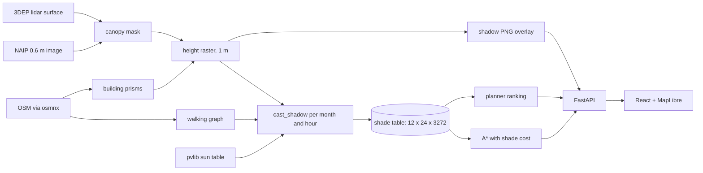

# Architecture

One page. The README has the stories; this is the map.

## Three parts

**Pipeline** (`api/pipeline`, run by `make data`). Offline and never imported by the API. It pulls raw data into `data/raw` (git-ignored) and writes the compact dataset in `data/pilot` (committed, 1.1 MB): the graph, building prisms, canopy polygons, two height rasters, the shade table and a temperature climatology. Each step is one module and writes one file.

**Model** (`api/shadewalk`). `geo.py` defines a tangent-plane frame in metres where +y is true north and the grid is aligned with longitude and latitude. `shade/raster.py` casts shadows: the height raster is resampled into a frame whose columns point at the sun, and a suffix maximum along each row answers "is anything toward the sun tall enough to block it" for every cell at once. `routing.py` is A* over adjacency lists with the PRD cost, plus a bisection on the weight that enforces the detour cap. `planner.py` multiplies sun exposure by nearby bus stops, rail stops and schools.

**Serving** (`api/shadewalk/main.py`, `web/`). The API loads everything into memory at start and answers a route in a few milliseconds. The front end is one React page around a MapLibre map with three modes.

## Storage

`Store` is a two-method protocol. `FileStore` reads `data/pilot` directly and is what the tests use. `PostgisStore` seeds the same files into PostGIS (fingerprinted, so it reloads only when they change), reads the graph and shade table back from it, and answers the planner's proximity question with one `ST_DWithin` join on geography. A test asserts the SQL join and its numpy twin count the same things. Rasters and the climatology stay on disk in both modes.

## Invariants

- Segment ids are 0 to n-1 and index the shade table. `Network.build` refuses anything else.
- Shade with canopy is never below shade without it, for any segment and slot.
- Cost is never below length, so straight-line distance is an admissible heuristic for every slider value.
- The shadiest route is never sunnier than the shortest, and never longer than `detour_cap(weight)` times it.
- `api/validation/independent.py` imports nothing from `shadewalk.shade`, `pipeline` or pvlib. A test parses its imports.
- The API makes no network call unless `WEATHER_PROVIDER=open-meteo`, and then a failure falls back to the climatology.

## Time

The shade table is hourly on the 15th of each month in local clock time. A departure at 15:20 blends the 15:00 and 16:00 rows. The sun table is every 15 minutes, which is the step of the map's time slider; the shadow overlay for a slot is cast on demand in about 0.4 s and cached.

## Decisions I would revisit

- Snapping to the nearest node, not the nearest point on an edge. Fine downtown where nodes are 30 m apart, wrong for long blocks.
- One shade value per segment per hour ignores that a 20 minute walk ends in different light than it started.
- Buildings are OSM heights by decision. The lidar surface is already fetched and disagrees with `3 m per level` by a median 5.9 m, so it should become a height source.
