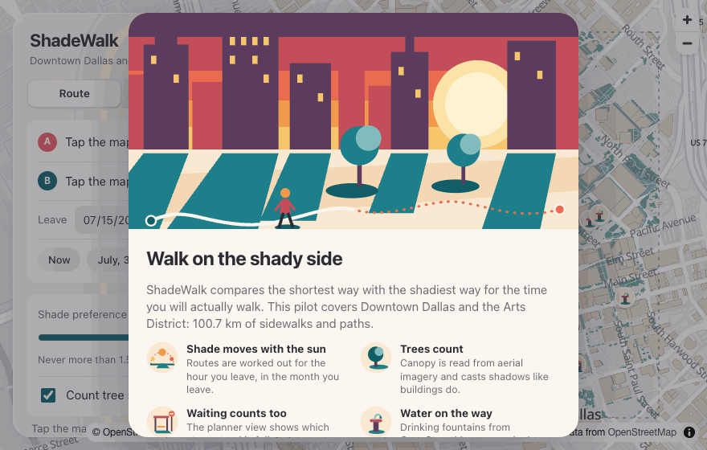
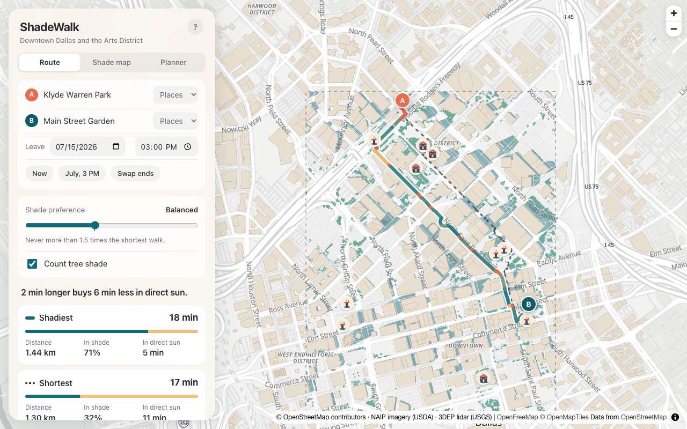
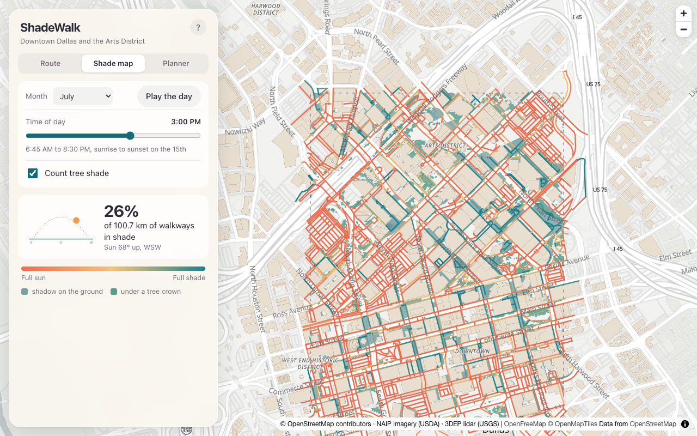
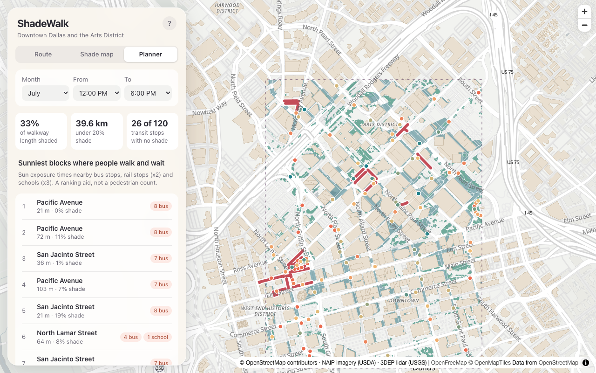

<div align="center">

# ShadeWalk

### the walking route with the most shade, for the hour you are leaving

[](api)
[](web)
[](api/shadewalk/store)
[](api/tests)
[](LICENSE)

<br>



</div>

<br>

Dallas in July reaches 34 °C by mid afternoon on an average day, and a map app will happily send you down the sunny side of the street because it is a few metres shorter. ShadeWalk works out where the shadows of every building and tree fall at the time you plan to leave, then finds the walk that keeps you under them.

For the route in the screenshot below, from Klyde Warren Park to Main Street Garden at 3 PM on July 15, the shortest walk is 32% shaded. The shadiest is 71% shaded and takes about two minutes longer. Ask for a walk at noon in January, when the average is 9 °C, and the two routes come back identical. Below 20 °C the model treats sun on a walk as welcome.

> **Read this before trusting it with a real walk.** The shade model has never been checked against anyone standing on a pavement with a notebook. It covers 1.8 square kilometres of downtown Dallas. It is a portfolio project about a real problem, and it should be read as a careful estimate.

<p align="center"></p>

<br>

## Table of contents

- [Run it](#run-it)
- [The pilot area](#the-pilot-area)
- [Where the shade comes from](#where-the-shade-comes-from)
- [Routing, and the 1.5x promise](#routing-and-the-15x-promise)
- [The views](#the-views)
- [The parts that fought back](#the-parts-that-fought-back)
- [Acceptance tests](#acceptance-tests)
- [Limitations](#limitations)
- [Next](#next)
- [Layout and credits](#layout-and-credits)

<br>

## Run it

```bash
git clone https://github.com/ayaan-gupta/shadewalk && cd shadewalk && make dev
```

Open http://localhost:4107. You need Docker, Python 3.12, Node 22 and `make`.

`make dev` brings up PostGIS in a container with the committed pilot dataset loaded, and serves the API beside the web app. From a fresh clone both were answering after 33 seconds. Without Docker, `make dev-files` runs the same app straight from the files in `data/pilot`, and `make dev` falls back to that by itself if Docker is not running.

No API key is involved anywhere. Ports are 4107 for the web app, 8107 for the API and 5507 for Postgres, with every setting listed in [.env.example](.env.example).

<br>

## The pilot area

Downtown Dallas and the Arts District. I pulled four candidate areas and kept this one because it has the towers that make afternoon shade and, more usefully, sidewalks mapped as separate ways on both sides of most streets. A router can only send you to the shady side of a street if the map knows the street has two sides.

| | |
|---|---|
| Walkable network | 3,272 segments, 100.7 km |
| Of which sidewalk | 60.7 km |
| Buildings | 883 prisms, including a 400 m margin so neighbours can cast shadows in |
| Tree canopy | 1,989 polygons covering 6.3% of the ground |
| Transit | 104 bus stops and 16 rail stops |
| Committed dataset | 1.1 MB in 8 files |

Everything is from public sources and fetched without a key: the walking graph and buildings from OpenStreetMap, imagery from the USDA's NAIP programme, lidar from the USGS, and ten years of hourly temperatures from ERA5.

<br>

## Where the shade comes from

**The sun.** pvlib gives the sun's position every 15 minutes for the 15th of each month.

**Buildings.** Each OSM footprint becomes a prism. Height comes from the `height` tag when there is one, or from the level count at 3 metres a floor. Failing both, it is a default of 10 metres. That default covers 40.8% of footprint area, which is the single shakiest number in the project.

**Trees.** The PRD suggests segmenting canopy from 1 metre NAIP imagery. Vegetation is found by NDVI on a July 2022 image, and a 2018 lidar surface separates trees from lawn: green things standing at least 2.5 metres above the ground are canopy. That also gives every crown a real height in place of an assumed 8 metres.

**Casting.** Shadows are cast on a 1 metre height raster. Each of the 3,272 segments is sampled every metre, and its shade fraction is the share of those samples in shadow.

**Precomputing.** The result is a table of 12 months by 24 hours by 3,272 segments, in two layers so tree shade can be switched off. It takes 24 seconds to build. At request time, routing is a lookup.

<p align="center"></p>
<p align="center"><sub>3 PM in July. A quarter of the network is in shade, and you can see it is mostly the north-south streets behind the towers.</sub></p>

<br>

## Routing, and the 1.5x promise

The cost of a segment is the PRD's formula:

```
cost = length * (1 + w * (1 - shade) * heat)
```

`w` is the preference slider. `heat` rises with temperature, from zero at 20 °C to one at 35 °C, so shade stops mattering on a cool day. The search is a hand-written A* that I checked against Dijkstra on 40 pairs.

The PRD also promises that the shadiest route is never more than 1.5 times the shortest unless the user raises the slider. I first tried to get that from the cost function alone, and the arithmetic is unkind: the cost can only guarantee a 1.5x bound when `w * heat` is at most 0.5, which is too weak to change many routes. So the promise is enforced as a constraint. The router bisects `w` downward until the route fits under the cap, ten steps at most, and a response still takes about 5 ms.

Past the slider's default the cap relaxes, reaching 3x at the maximum setting. That is my reading of "unless the user raises the slider", and the interface says "Never more than 1.5 times the shortest walk" only while it is true.

<br>

## The views

**Route.** You give it two points and a departure time. You get both routes with distance, minutes, the percentage in shade and the minutes spent in direct sun. A share card exports as an image.

**Shade map.** A time slider that recolours every walkway and redraws the shadow layer from the model. "Play the day" sweeps from sunrise to sunset.

**Planner.** The PRD asks for a view that shows the streets with the least shade and the most foot traffic indicators. Blocks near bus stops and schools are ranked by how much sun they take, in PostGIS SQL, and each transit stop is coloured by its own shade. This is the view I would show a city forester.

<p align="center"></p>

The illustrations are hand-written SVG. The brief does not let me generate images, so eight are requested in [assets/prompts.md](assets/prompts.md) and a PNG saved to `assets/generated` replaces the SVG of the same name. Map tiles and shadows are always data.

<br>

## The parts that fought back

**Overpass refused every connection while curl worked.** osmnx resolves `overpass-api.de` once and pins every later request to that one address. The name is a round robin over two machines, and the first one was refusing connections. curl quietly fell through to the second, which made the failure look like my code's fault. My first fix was longer retries, and it burned 25 minutes achieving nothing. The real fix probes the address osmnx is about to pin. Later Overpass stopped answering this machine altogether, so buildings and trees came through the OSM API's `map` call in four tiles. Both paths are in the pipeline.

**Shadow casting without marching rays.** Marching every cell toward the sun costs cells times shadow length, and a 200 metre tower under a 5 degree sun throws a shadow more than two kilometres long across a grid of 4.6 million cells. I resample the height raster into a frame whose columns point at the sun. Then the question "is anything sunward of me tall enough?" becomes a suffix maximum along each row, which numpy computes for the whole raster at once. A cast takes about 0.2 seconds however long the shadows are.

**Every shadow was half a metre short.** The first sanity check used a closed form: a 20 by 10 by 10 metre box with the sun due south at 45 degrees should shade exactly 200 square metres. The raster said 180. I was measuring distance between cell centres, but a building fills its cell, so its wall stands half a cell closer than its centre. Subtracting half a step gave 200.0 at half-metre cells.

**Texture did not separate trees from lawn.** The plan was NDVI plus local texture, on the theory that a tree crown is bumpier than grass. In this image the texture measure was *higher* over low vegetation than over tall, because downtown texture is dominated by building edges and tower shadows. Lidar height did the job texture could not.

**The first imagery read covered 10.9% of the grid.** Two NAIP tiles share the newest date and I took whichever the catalogue listed first. It was the wrong one. Tiles are now ranked by overlap and mosaicked.

Two of my own tests were also wrong where the code was right. One had an arithmetic slip. The other assumed no bus stop sits exactly on a sidewalk, and 21 of them do, because in OSM the stop is a node of the way.

<br>

## Acceptance tests

Measured by `make acceptance` on 200 seeded origin and destination pairs, 300 metres to 1.5 kilometres apart, for July 15 at 3 PM with the slider at its default.

| PRD test | Result | Measured |
|---|---|---|
| Shadiest route has at least 25% more shaded length than the shortest, for at least 50% of pairs | Met | 174 of 200 pairs, 87%. With buildings alone, 83.5%. |
| Shadiest is never more than 1.5 times the shortest distance unless the slider is raised | Met | Largest ratio 1.259. In a stress run across four months and four hours with the heat factor forced up, 1.496, so the cap binds and holds. |
| Hand-checked shade fractions at 20 segments agree within 15 points | **Not met as written** | Nobody stood on those segments. A second, independent computation agrees on all 20, with a largest difference of 2.7 points. |
| Route response under 1 second | Met | Median 2.4 ms and 95th percentile 4.7 ms over HTTP with the PostGIS store. |

That third row deserves its explanation. The PRD wants a person on site. What I could build from a desk is a second implementation: one ray per 0.25 metre sample against the exact vector footprints, with its own sun equations and its own map projection. A test parses its imports to prove it shares no code with the production shadow caster. It does share the input data, so a wrong building height in OSM fools both of them equally. The protocol a person would follow for the same 20 segments, with coordinates and a blank sheet, is in [docs/field-validation.md](docs/field-validation.md).

The first row surprised me by how easily it passed. The reason is those two-sided sidewalks again: the router can often just cross the street, for a median detour of 5%.

<br>

## Limitations

- **No field validation.** See above. This is the one that matters most.
- **One pilot area.** Nothing outside the box routes.
- **Two fifths of building footprint has a guessed height.** For buildings where OSM has only a level count, 3 metres a floor also under-reads this district: the OSM-derived median is 15.0 metres and the lidar median 22.3.
- **The trees are from 2018.** That is the lidar year, so anything planted since is mostly missing. Of 572 trees mapped by hand in OSM, 53% fall within 3 metres of segmented canopy.
- **Canopy is a solid block from the ground up.** Real crowns let low sun underneath.
- **The ground is flat and the freeway decks are missing,** so sidewalks under I-345 read as sunny. Awnings and bus shelters are invisible too.
- **A walk is treated as instantaneous,** and the table holds one day per month at hourly steps.
- **Parking aisles and service lanes count as walkable,** 21.8 km of them. Some are neither pleasant nor public.
- **The heat factor is a straight line on air temperature.** No humidity and no heat index.
- **"Cooling" markers are OSM libraries and museums,** with no opening hours. Treat them as a hint until an official cooling centre list is wired in.
- **The planner's demand measure is a count of nearby stops and schools.** It is a stand-in for pedestrian volume I do not have.
- The live weather provider is tested against a recorded response only. The default is a committed climatology.

<br>

## Next

1. Use the lidar surface as the height source wherever OSM has none, then re-run the acceptance tests to see how far the routes move.
2. Do the field protocol. Twenty segments and one July afternoon would turn the weakest row in that table into the strongest.
3. Make shade at the bus stop a first-class result: rank stops by minutes of sun during service hours and join ridership, so the planner view argues for shelters as well as trees.

<br>

## Layout and credits

```
api/pipeline/      fetches the public data and builds the network and shade table
api/shadewalk/     FastAPI app: routing, shade lookup, planner, weather, the two stores
api/validation/    the independent 20 segment check and the acceptance script
api/tests/         42 tests grouped by milestone
web/               the React and MapLibre front end
data/pilot/        the committed dataset for downtown Dallas
docs/              measurements, the field protocol
assets/            prompts.md (image requests), interim/ (hand-written SVG)
```

[ARCHITECTURE.md](ARCHITECTURE.md) has the data flow and the decisions I would revisit.

Map data is © [OpenStreetMap](https://www.openstreetmap.org/copyright) contributors. Imagery is from the USDA National Agriculture Imagery Program and lidar from the USGS 3D Elevation Program, both reached through Microsoft's Planetary Computer. Temperatures are ERA5 by way of [Open-Meteo](https://open-meteo.com). Sun positions come from [pvlib](https://pvlib-python.readthedocs.io), and the base map from [OpenFreeMap](https://openfreemap.org).

## License

MIT. See [LICENSE](LICENSE).
